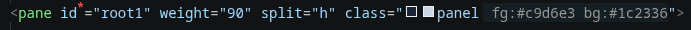

# XML markup

DABT pages are plain `.xml` files with a `<tui>` root (see the framework's [markup guide](https://dinosaursarecute.github.io/DinosAmazingBashTui/guide/markup)). DABT Tools recognizes a page **by its content**, not its name. Any XML document containing `<tui`, `<pane`, or a `noNamespaceSchemaLocation` pointing at `tui.xsd` gets the features below. Other XML files in your workspace are left alone.

All element and attribute knowledge comes from `share/tui.xsd` in the active [data source](data-source.md). The bundled fallback currently targets DABT 0.0.24-preRelease: 54 elements and 1,311 effective attributes, including attributes and child elements declared through shared XSD groups. Its markup includes layout aliases, floating layers, reusable templates and components, loops, conditions, addons, grid/fixed splits and tabs. With a live data source, schema changes appear without an extension update.

For markup behavior and examples, see the framework's [markup reference](https://dinosaursarecute.github.io/DinosAmazingBashTui/guide/markup) and [grid layouts and tabs](https://dinosaursarecute.github.io/DinosAmazingBashTui/guide/grid-layouts-and-tabs).



## Completion

| Where the cursor is | What's offered |
|---|---|
| After `<` | Elements **allowed as children of the enclosing tag** (or `<tui>` at the top). Picking one inserts it with its required attributes as tab stops. |
| Inside a tag | That element's attributes not yet written. Required ones sort first and are marked `, required`. Enum attributes open a dropdown of their values. |
| In an enum value (`split="`, `border="`, `align="`...) | The allowed values from the schema. |
| In `action=`, `on_visit=`, `on_change=`, `submit=` | Every function defined in the page's `<script src="...">` files (with `file:line`), plus DABT's built-in `tui.action.*` and `tui.nav.*` commands. |
| In `pane="` | Every `<pane id="...">` declared in this document. |
| In `page="` | Sibling `.xml` files in the same folder. |
| In `class="` | Every class in the page's `<theme src="...">` stylesheet, with its fg/bg/mods. See [themes-and-colors.md](themes-and-colors.md). |

## Hover

- **Tag name**: the element's full attribute list (required ones bare, optional ones in `[...]`) and its schema doc.
- **Attribute name**: type, whether it's required, allowed values and doc.
- **Callback value** (`action="home_save"`): for a DABT built-in, its API card. For your own function, where it's defined. If it's not defined anywhere, a **⚠ warning** naming the scripts that were searched. That's the quickest way to catch a typo in a callback name.

## Go to definition (F12 / Ctrl+click)

| On | Jumps to |
|---|---|
| `action=` / `on_visit=` / `on_change=` / `submit=` | The function's definition in the page's `<script src>` files. |
| `src="..."` (`<script>`, `<theme>`, `<include>`) | That file. |
| `page="other.xml"` | That page. |

Paths resolve relative to the page's own folder, the same way DABT resolves them.

## Required-attribute markers

Every **required** attribute you've written gets a small red `*` after its name. You can see which attributes a tag can't do without, without hovering. The markers update as you type.

## Diagnostics

Pages are checked as you type against the schema and the files they point at: unknown elements and attributes, missing required attributes, callbacks with no function behind them, missing `src`/`page` files, duplicate ids and theme classes the theme does not define. On open and save the framework's own validator also runs (needs a DABT install) and its findings, layout rules included, show with source `dabt validate`. All codes are in the [lint rules reference](../reference/lint-rules.md#markup-rules).

## Outline and callback lenses

The Outline view and breadcrumbs list a page's panes and widgets by `id`, nested the way they are written. In a `*_callbacks.sh` file the Outline lists functions, tagged `callback` or `helper` (leading `_`), and a CodeLens above each callback shows how many markup attributes name it. Click it to jump to the uses. A callback with no markup use and no call in the script is a candidate for deletion.

## New Page

**DABT: New Page (XML + callbacks.sh)...** asks for a name and writes a page and its callbacks file into the folder of the current editor (or the workspace root). It opens them side by side:

```xml
<!-- settings.xml -->
<tui xmlns:xsi="http://www.w3.org/2001/XMLSchema-instance" xsi:noNamespaceSchemaLocation="../tui.xsd" on_visit="settings_visit">
  <script src="settings_callbacks.sh"/>

  <pane id="root" split="v" title="settings" border="single">
    <pane id="main" weight="100"/>
  </pane>

  <label id="lbl_title" pane="main" row="0" text="settings"/>
</tui>
```

```bash
#!/usr/bin/env bash
# settings_callbacks.sh - callbacks for settings.xml

settings_visit() {
    :
}
```

It won't overwrite files: if either one already exists, it stops and says so.

## Insert Element

**DABT: Insert Element...** (XML files only) lists every element with its doc, then asks:

- **Required attributes only**: a quick insert.
- **All attributes**: every attribute as a tab stop, **required first**, each pre-filled with a sensible default (`1` for positive integers, `0` for integers, `true` for booleans, a dropdown for enums). Tab moves through them in order.

Elements that can have children are inserted with an open/close pair and the cursor between them.
